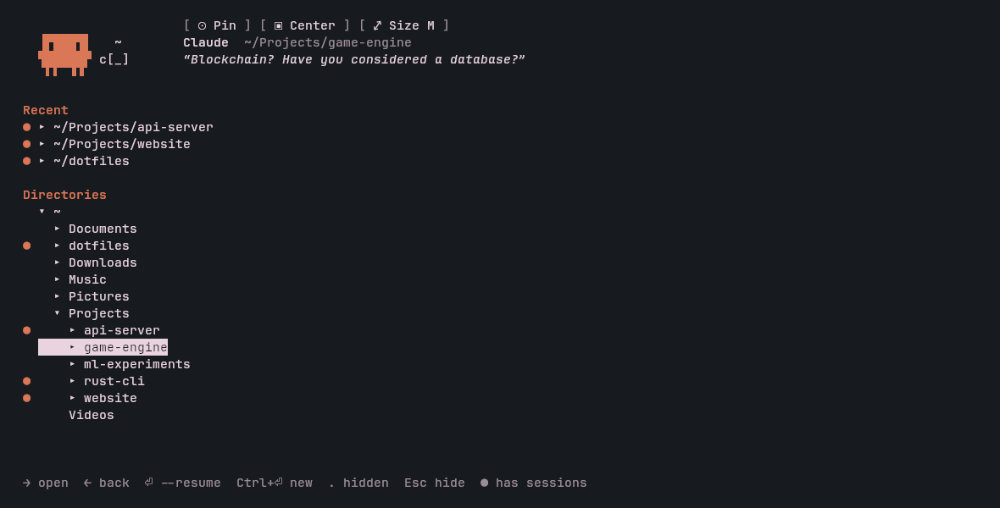
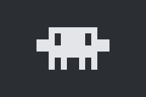
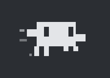
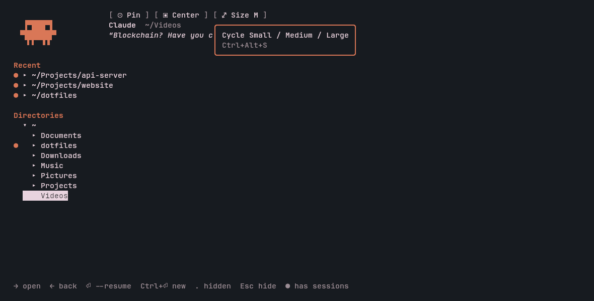

# clawd-plasma

A [Claude Code](https://claude.com/claude-code) companion for KDE Plasma 6.

- **Panel widget**: a pixel-art Clawd that blinks every 10 seconds and runs while Claude is working.
- **Drop-down terminal**: click Clawd (or press ``Meta+` ``) to open a kitty window with a directory picker that starts `claude` or `claude --resume` where you choose.
- **Animated header**: Clawd plays 21 animations next to 200+ geeky quotes about coding, AI and tech.



| Idle (blinks every 10 s) | Claude is working |
|:---:|:---:|
|  |  |

## Requirements

- KDE Plasma 6 on Wayland (KWin)
- [kitty](https://sw.kovidgoyal.net/kitty/)
- Python 3, `jq`, `qdbus6`, `kpackagetool6`
- Claude Code (`claude` on your `PATH`, or in `~/.local/bin`)

## Install

```sh
git clone https://github.com/joelferreira14/clawd-plasma.git
cd clawd-plasma
./install.sh
```

`install.sh` is safe to re-run. It:

1. installs or upgrades the plasmoid (`org.joelferreira.clawd`);
2. installs and enables the `clawd` KWin script;
3. adds Clawd's hooks to `~/.claude/settings.json`, after backing it up to `~/.claude/settings.json.pre-clawd`.

Then add **Clawd** to a panel (right-click the panel → *Add Widgets…*). New Claude Code sessions pick up the hooks automatically.

## Usage

### Directory picker

| Key | Action |
|---|---|
| `↑` `↓` | Move |
| `→` | Expand a directory |
| `←` | Collapse, or go back to the parent |
| `Enter` | `claude --resume` in that directory (a new session if it has none) |
| `Ctrl+Enter` | `claude`, a new session |
| `.` | Show or hide hidden directories |
| `Esc` | Hide the window |

The five most recent directories are listed at the top. `●` marks directories that already have Claude sessions. When `claude` exits, the picker comes back.

### Window buttons

The buttons sit above the picker. Hover over one to see what it does. The shortcuts also work while `claude` is running.



| Button | Shortcut | Action |
|---|---|---|
| `⊙ Pin` | `Ctrl+Alt+P` | Keep the window open when it loses focus |
| `▣ Center` / `◧ Left` / `◨ Right` | `Ctrl+Alt+D` | Drop-down under the top panel, or a full-height side panel |
| `⤢ Size` | `Ctrl+Alt+S` | Cycle Small / Medium / Large (side panels change width only) |

The settings are saved in `~/.local/state/clawd/window`.

### Shortcut

To change the show/hide shortcut, right-click Clawd → *Configure Clawd…* → *Keyboard Shortcuts*.

## Configuration

| What | Where |
|---|---|
| Monitor for the window (default `DP-1`) | `OUTPUT` in `kwin/contents/code/main.js` |
| Window sizes | `CENTER_SIZES` and `SIDE_WIDTHS` in `kwin/contents/code/main.js` |
| Quotes, one per line | `package/contents/bin/quotes.txt` |

Re-run `./install.sh` after editing. Use `kscreen-doctor -o` to list your monitor names.

## How it works

| Part | Role |
|---|---|
| `package/` | The plasmoid: the QML Clawd plus the helper scripts in `contents/bin` |
| `clawd-picker` | Directory picker and animated header (Python, runs inside kitty) |
| `clawd-toggle` | Starts the kitty window (`--class clawd`), or asks KWin to show or hide it |
| `clawd-window` | Saves pin/position/size and pushes them to KWin through keyless shortcuts |
| `clawd-hook` / `clawd-status` | Claude Code hooks write each session's state to `~/.cache/clawd/`; the widget polls it to know when to run |
| `kwin/` | KWin script that places the window, keeps it above, and hides it on focus loss |

## Uninstall

```sh
kpackagetool6 -t Plasma/Applet -r org.joelferreira.clawd
kpackagetool6 -t KWin/Script -r clawd
kwriteconfig6 --file kwinrc --group Plugins --key clawdEnabled false
qdbus6 org.kde.KWin /KWin reconfigure
```

Then remove the `clawd-hook` entries from `~/.claude/settings.json`, or restore `~/.claude/settings.json.pre-clawd` if you have changed nothing since.

## License

[MIT](LICENSE)
