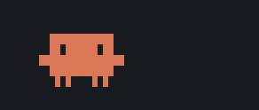

# Clawd's moves

Every animation in clawd-companion. The GIFs are rendered from the same frames the widget plays.

## Panel widget

The panel sprite is drawn in your panel's text colour.

| Idle | Working |
|:---:|:---:|
|  |  |
| Blinks every 10 seconds. | Runs while Claude is mid-turn: push off, pass, reach, pass. |

## Picker header

Above the directory picker, Clawd picks one of these 21 moves at random every 3 to 7 seconds, next to a rotating quote. Between moves it idles and blinks.

| Preview | Move | Length |
|:---:|---|---:|
|  | **blink** The idle blink between moves. | 0.3 s |
|  | **look** Glances left, then right. | 2.2 s |
|  | **walk** Strolls across the header and back. | 3.7 s |
|  | **jump** Three happy hops with arms up. | 2.1 s |
|  | **wave** Waves hello with one arm. | 2.5 s |
|  | **sleep** Dozes off. `z Z z` | 7.6 s |
|  | **dance** Sways side to side to `♪ ♫`. | 3.7 s |
|  | **idea** Looks up, sparkles, gets it. `!` | 2.1 s |
|  | **type** Hammers the keyboard while bits fly. | 4.9 s |
|  | **love** Happy eyes and floating hearts. | 2.5 s |
|  | **confused** Looks around, puzzled. `? ?` | 2.3 s |
|  | **coffee** Sips from a steaming mug. `ahh` | 3.5 s |
|  | **bug_hunt** Chases a bug off the edge. `gotcha!` | 2.9 s |
|  | **glitch** Dissolves into noise and reboots. | 1.5 s |
|  | **compile** Watches the progress bar fill. `✓ build ok` | 3.6 s |
|  | **think** A thought bubble that ends in a eureka. | 3.5 s |
|  | **wink** A cheeky wink. | 1.1 s |
|  | **stretch** Arms up for a long stretch. | 2.4 s |
|  | **git_push** Sends arrows up to the remote. `pushed ✓` | 3.1 s |
|  | **duck** Ducks out of sight, peeks, pops up. `boo!` | 2.7 s |
|  | **moonwalk** Walks out, moonwalks back. `hee-hee` | 4.4 s |
|  | **sneeze** `a-a-ACHOO!` …`sorry` | 2.8 s |

Some moves have random parts (`glitch`, `type`), so they look a little different each time.
